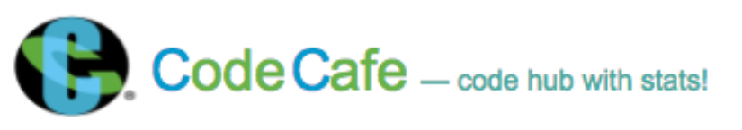

# Code Cafe ☕

A web application for browsing, searching, and analyzing coding submissions from HackerEarth. Code Cafe provides an intuitive interface to view code submissions with powerful filtering and statistical analysis features.



## Features

- **Search Functionality**: Search submissions by title, difficulty level, or programming language (case-sensitive)
- **Status Filtering**: Filter submissions by compilation status:
  - Accepted
  - Wrong Answer
  - Time Limit Exceeded
  - Skipped
- **Real-time Statistics**:
  - Top 5 programming languages used
  - Top 2 most attempted problems
  - Submissions breakdown by difficulty level
  - Total submission count
- **Responsive Design**: Clean, user-friendly interface built with Bootstrap
- **Loading Indicators**: Visual feedback during data fetching

## Technology Stack

### Frontend
- **AngularJS** (v1.5.8) - JavaScript MVC framework
- **Bootstrap** (v3.3.7) - CSS framework for responsive design
- **Lodash** (v4.15.0) - Utility library for data manipulation
- **Angular UI Bootstrap** (v2.1.3) - Bootstrap components for AngularJS

### Backend
- **Node.js** - JavaScript runtime
- **Express.js** - Minimal web server framework

## Prerequisites

Before running this application, ensure you have the following installed:

- **Node.js** (v12.0 or higher recommended)
- **npm** (comes with Node.js)

## Installation

1. **Clone the repository**
   ```bash
   git clone <repository-url>
   cd codecafe
   ```

2. **Install dependencies**
   ```bash
   npm install express
   ```

3. **Start the server**
   ```bash
   node server.js
   ```

4. **Access the application**

   Open your browser and navigate to:
   ```
   http://localhost:1111
   ```

## Usage

### Searching Submissions

Use the search bar at the top to filter submissions. The search is **case-sensitive** and matches against:
- Problem title
- Difficulty level
- Programming language

```
Example: Search "Python" to see all Python submissions
```

### Filtering by Status

Use the radio buttons in the right sidebar to filter submissions by compilation status:

- **Accepted**: Successfully compiled and passed all test cases
- **Wrong Answer**: Compiled but failed test cases
- **Time Limit Exceeded**: Execution took too long
- **Skipped**: Submission was skipped

### Viewing Statistics

The statistics panel on the right displays:
- Distribution of programming languages across all submissions
- Most frequently attempted problems
- Breakdown of submissions by difficulty level
- Total number of submissions

## Project Structure

```
codecafe/
├── img/                          # Image assets
│   ├── logo.png                  # Application logo
│   ├── loading.gif               # Loading spinner
│   └── concrete_seamless.png     # Background texture
├── controllers/                  # AngularJS controllers
│   └── searchController.js       # Main search and filter logic
├── factories/                    # AngularJS services
│   └── codeFactory.js           # API communication service
├── app.js                        # AngularJS module initialization
├── index.html                    # Main HTML template
├── server.js                     # Express server configuration
└── style.css                     # Custom styles
```

## API Integration

The application fetches data from the HackerEarth API:

```
Endpoint: http://hackerearth.0x10.info/api/ctz_coders
Parameters:
  - type: json
  - query: list_submissions
  - page: 1
```

## Configuration

### Port Configuration

By default, the server runs on port **1111**. To change the port, edit `server.js`:

```javascript
app.listen(1111, function() {
    console.log('mAGIC HAPPENING AT 1111');
});
```

### API Endpoint

To modify the API endpoint, edit `factories/codeFactory.js`:

```javascript
return $http.get('http://hackerearth.0x10.info/api/ctz_coders?type=json&query=list_submissions&page=1')
```

## Browser Compatibility

- Chrome (recommended)
- Firefox
- Safari
- Edge

**Note**: This application uses AngularJS 1.x and may not support Internet Explorer without polyfills.

## Contributing

Contributions are welcome! Please follow these guidelines:

1. Fork the repository
2. Create a feature branch (`git checkout -b feature/amazing-feature`)
3. Commit your changes (`git commit -m 'Add amazing feature'`)
4. Push to the branch (`git push origin feature/amazing-feature`)
5. Open a Pull Request

### Code Style

- Use consistent indentation (4 spaces)
- Follow JavaScript Standard Style
- Add comments for complex logic
- Keep functions small and focused

## Known Issues

- Search is case-sensitive (feature, not a bug)
- API endpoint is hardcoded (consider moving to configuration file)
- No error handling for failed API requests beyond console logging
- Uses deprecated AngularJS 1.x (consider upgrading to modern framework)

## Troubleshooting

### Server won't start
- Ensure port 1111 is not already in use
- Check that Express is installed: `npm list express`

### No data displays
- Check browser console for errors
- Verify API endpoint is accessible
- Ensure internet connection is active

### Search not working
- Remember that search is case-sensitive
- Clear search box and try again
- Check browser console for JavaScript errors

## Future Enhancements

- [ ] Pagination for large datasets
- [ ] Export functionality (CSV, JSON)
- [ ] Code syntax highlighting
- [ ] User authentication
- [ ] Save favorite submissions
- [ ] Dark mode theme
- [ ] Migrate to modern framework (React/Vue/Angular)
- [ ] Add unit tests
- [ ] API error handling and retry logic
- [ ] Configuration file for environment variables

## License

This project is open source and available under the MIT License.

## Support

For issues, questions, or contributions, please open an issue on the GitHub repository.

---

**Built with ❤️ using AngularJS and Express**
